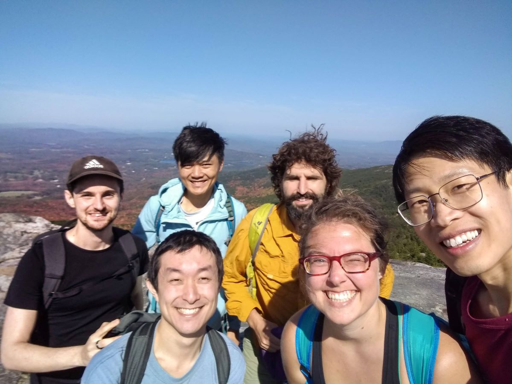
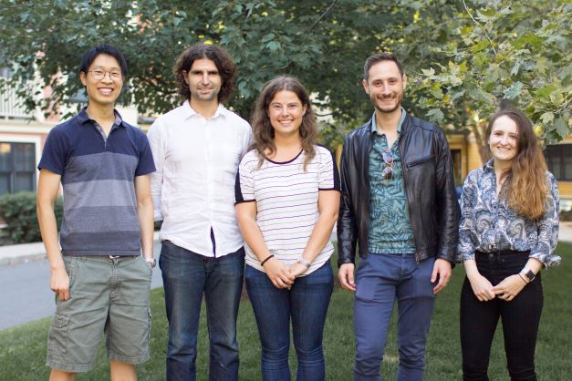

## Group Members










  
  <h4>{{ member.name }}</h4>
  <i>{{ member.info }}</i>
  <ul style="overflow: hidden">

  
  <li> {{ member.education1 }} </li>
  

  
  <li> {{ member.education1 }} </li>
  <li> {{ member.education2 }} </li>
  

  
  <li> {{ member.education1 }} </li>
  <li> {{ member.education2 }} </li>
  <li> {{ member.education3 }} </li>
  

  
  <li> {{ member.education1 }} </li>
  <li> {{ member.education2 }} </li>
  <li> {{ member.education3 }} </li>
  <li> {{ member.education4 }} </li>
  

  
  <li> {{ member.education1 }} </li>
  <li> {{ member.education2 }} </li>
  <li> {{ member.education3 }} </li>
  <li> {{ member.education4 }} </li>
  <li> {{ member.education5 }} </li>
  

  </ul>














 

## Openings

We will have open positions in 2027 for postdocs and students with very strong computational or statistical background and previous research experience in genetics or genomics. Potential research areas include analyses of somatic mutations as part of the [SMaHT Network](https://smaht.org) and analyses of emerging data modalities in biobank data sets. Please send your CV and a brief statement of your research interests to poruloh@broadinstitute.org if interested.

(Please note that we do not have positions available for summer interns or for students who have not already been admitted to a Boston-area PhD program; due to email volume, these queries will not receive responses.)

## Past Members

* [Nolan Kamitaki](https://nkamitaki.github.io) (HMS BIG PhD student, 2022-2026) &#8594; Postdoc with [Steve McCarroll](https://mccarrolllab.org), HMS
* [Simone Rubinacci](https://compstatgenlab.github.io) (Postdoc, 2023-2024) &#8594; Group Leader, FIMM
* [Margaux Hujoel](https://mhujoel.github.io) (Postdoc, 2020-2025) &#8594; Assistant Professor, UCLA
* [Ronen Mukamel](https://www.linkedin.com/in/ronen-mukamel-b9926659) (Instructor, 2019-2024) &#8594; Staff Bioinformatics Scientist, Illumina
* [Alison Barton](https://www.linkedin.com/in/alison-barton) (HMS BIG PhD student, 2018-2022) &#8594; Postdoc with [David Reich](https://reich.hms.harvard.edu), HMS
* [Max Sherman](https://www.linkedin.com/in/maxwellsh) (MIT EECS PhD student, 2018-2022) &#8594; Co-Founder & CTO, Serinus Biosciences

## Lab photos

Lab hike at Mount Monadnock, Oct 2023

  

Lab photo, Sep 2021

  

